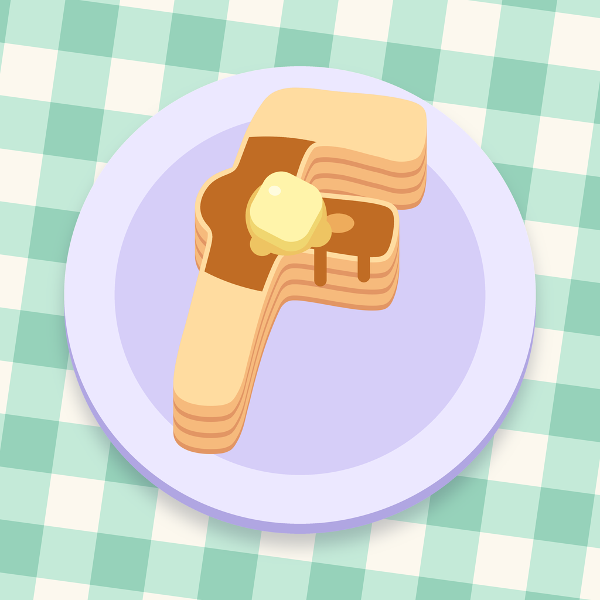

<div align="center">



# fstack

**A short stack of agent skills for everyday software engineering work.**

[](https://www.fedemas.dev/fstack)
[](.claude-plugin/plugin.json)
[](LICENSE)

</div>

---

## 📑 Contents

- [Install](#-install)
  - [Claude Code](#claude-code)
  - [GitHub Copilot](#github-copilot)
  - [Codex](#codex)
  - [Pi](#pi)
  - [oh-my-pi](#oh-my-pi)
  - [Any other agent](#any-other-agent)
- [Skills](#-skills)
  - [feature-design](#feature-design)
  - [pr-babysit](#pr-babysit)
  - [pr-ship](#pr-ship)
  - [resolve-merge-conflicts](#resolve-merge-conflicts)
  - [ux-brainstorm](#ux-brainstorm)
  - [ux-stress-test](#ux-stress-test)
- [License](#-license)

## 🥞 Install

fstack installs natively in Claude Code, GitHub Copilot, Codex, Pi, and oh-my-pi, and through the skills CLI in any other agent. Start a new session after installing so your agent loads the skills.

### Claude Code

```
/plugin install fstack --marketplace mastro993/fstack
```

<details>
<summary>On Claude Code older than 2.1.275</summary>

```
/plugin marketplace add mastro993/fstack
/plugin install fstack@fedemas
```

</details>

### GitHub Copilot

In Copilot CLI:

```sh
copilot plugin marketplace add mastro993/fstack
copilot plugin install fstack@fedemas
```

In VS Code, turn on the `chat.plugins.enabled` setting. VS Code then loads plugins installed with Copilot CLI; without the CLI, run **Chat: Install Plugin from Source** and enter `https://github.com/mastro993/fstack`.

### Codex

```sh
codex plugin marketplace add mastro993/fstack
codex plugin add fstack@fedemas
```

### Pi

```sh
pi install git:github.com/mastro993/fstack
```

Add `-l` to install for the current project only. Pi ships without subagents, which **ux-stress-test** needs, so add a subagent package from the [Pi package gallery](https://pi.dev/packages) before you run it.

### oh-my-pi

```sh
omp plugin marketplace add mastro993/fstack
omp plugin install fstack@fedemas
```

Add `--scope project` to install for the current project only.

### Any other agent

The [skills CLI](https://github.com/vercel-labs/skills) installs the skills into Cursor, OpenCode, Gemini CLI, Windsurf, and [many more agents](https://github.com/vercel-labs/skills/blob/main/docs/agents.md):

```sh
npx skills add mastro993/fstack
```

It asks which skills and agents you want, and installs into the current project unless you add `-g`. To skip the questions, name them:

```sh
npx skills add mastro993/fstack --skill pr-babysit --agent cursor -g -y
```

## 🧈 Skills

| Skill | What it does |
| --- | --- |
| [**feature-design**](skills/feature-design/SKILL.md) | Turns a rough idea into a spec ready to build. Your agent checks the idea against your docs, code, and outside research, tells you what's wrong with it, settles the product decisions in at most three short rounds of questions, makes and explains the technical ones, and records it all as decision records, a glossary, and a spec, then opens issues or starts the build in a fresh session. |
| [**pr-babysit**](skills/pr-babysit/SKILL.md) | Watches a pull request through CI and review. Your agent fixes failing checks, addresses or answers review comments (bots included), pushes, re-requests review, tells you when the PR is ready to merge, and keeps watching until it lands. |
| [**pr-ship**](skills/pr-ship/SKILL.md) | Ships a change. Your agent opens the PR or marks your draft ready, babysits it with pr-babysit, keeps asking the automated reviewers for another pass until one comes back clean, and merges it. |
| [**resolve-merge-conflicts**](skills/resolve-merge-conflicts/SKILL.md) | Resolves merge and rebase conflicts by what each side meant. Your agent reads the commits, pull requests, issues, and tickets behind both sides, keeps both changes where they fit together, sides with the change you're landing where they can't, runs your checks and the app, and finishes the merge or the whole rebase. |
| [**ux-brainstorm**](skills/ux-brainstorm/SKILL.md) | Designs a UI with you before anyone builds it. Your agent maps what exists, interviews you about behavior, finds real-world inspiration, and lets you pick between interactive prototypes right in the chat, then hands off a plan that maps every element to your components. |
| [**ux-stress-test**](skills/ux-stress-test/SKILL.md) | Five first-time-user personas try to reach first success in your web app in a real browser. Your agent ranks the friction they hit, fixes what you choose, and reruns the personas blind to prove the fixes, or opens issues for later. |

### feature-design

You own what the feature is for; your agent owns how it gets built:

- 🔎 **Ground**: reads your docs, decision records, glossary, code, and tracker, and researches how others solved the same problem, before asking anything.
- 🥊 **Challenge**: tells you what's wrong with the idea as stated (it exists, it contradicts a past decision, a smaller change does the job) and proposes a better shape.
- 🎤 **Interview**: at most three rounds of five questions, always with options to pick from, on scope, behavior, and UX only. Examples, diagrams, mockups, or a small prototype make sure you know what you're choosing.
- 📖 **Glossary**: pins down the words as you talk, and corrects the ones that clash with the project's.
- 🛠️ **Design**: makes the technical decisions itself, then explains each one in plain English: what, and why it follows from what you asked for.
- 🗂️ **Document**: one decision record per non-trivial decision in `docs/adr/`, the glossary in `GLOSSARY.md`, and a full spec in `docs/specs/`. The next design session reads them first.
- 🚀 **Handoff**: opens issues as shippable slices with their dependencies and implementation order, starts the build in a fresh session, or both.

**Needs:** a question tool such as AskUserQuestion (optional; otherwise lettered options in chat), the [Exa MCP](https://exa.ai) for research (otherwise your agent's own web search), and an issue tracker CLI or MCP such as [gh](https://cli.github.com) for the issues handoff.

**Try it:** ask your agent *"I'm thinking of adding team invites, help me design it"* or *"design how offline mode should work with me"*.

### pr-babysit

Your agent waits on GitHub without burning turns and reacts as things happen:

- 🔴 **Failing check**: reads the failed log once, fixes the root cause, reruns infra flakes once, and stops after two failed attempts.
- 💬 **Review comment**: fixes what's clear, answers questions from the code, checks bot claims before acting on them, and asks you about design calls or pushback.
- 🔁 **After a push**: replies on each thread with the fix commit, re-requests review, and leaves resolving threads to the reviewer.
- 🔀 **Base moved**: when another PR lands and leaves this one conflicting or behind, merges the base in (never rebases or force-pushes) and resolves the conflicts with [resolve-merge-conflicts](#resolve-merge-conflicts).
- ✅ **Ready**: tells you, then keeps watching until the PR is merged or closed, or you say stop. It never merges unless you asked; landing it is [pr-ship](#pr-ship)'s job.

Ask only to be told ("let me know when CI finishes") and it reports without touching anything.

**Needs:** resolve-merge-conflicts (install both), an authenticated [gh](https://cli.github.com) CLI, git, python3, and a checkout of the PR's branch to push fixes from.

**Try it:** ask your agent to *"babysit PR #42"* or *"watch my PR and fix whatever CI or review throws at it"*.

### pr-ship

Say the word and your agent takes the change all the way to the base branch:

- 🚀 **Open**: commits and pushes the change if needed, then opens the PR from your template, or marks your draft ready.
- 🍼 **Babysit**: hands failing checks, review threads, and a moving base to [pr-babysit](#pr-babysit).
- 🤖 **Review rounds**: gets each automated reviewer on the repo (CodeRabbit, Pullfrog, Claude, Copilot, Codex, Bugbot, Greptile, and more) to review the latest push, fixes what they find, and asks again until a round comes back clean. If three rounds of fixes still turn up new findings, it asks you whether to keep going.
- ✅ **Merge**: squash-merges when the repo allows it (otherwise with the method it allows), pinned to the commit that passed, and only through the repo's rules, never with `--admin`.

**Needs:** pr-babysit and resolve-merge-conflicts (install all three) and everything they need.

**Try it:** ask your agent to *"ship it"*, *"get this into main"*, or *"merge #42"*.

### resolve-merge-conflicts

Git shows you where two changes collide; your agent works out why each one was made:

- 🧭 **Start**: merges or rebases the way you asked (otherwise the repo's convention, or a merge for a branch that's already pushed), with the common ancestor shown in every conflict, and leaves a dirty checkout alone by working in a separate worktree.
- 🔎 **Intent**: for every conflict, reads the commits on both sides, their pull requests and reviews, the issues they close, and any ticket they mention, and writes down what each side meant before editing a line.
- 🤝 **Resolve**: keeps both changes when they can coexist, adapting one to the other's renames and moves. When they can't, it keeps the change you're landing and tells you what the other side loses. It asks first only if that would drop a security or data-loss fix. It never invents behavior neither side had, and regenerates lockfiles and generated code instead of hand-merging them.
- ✅ **Check**: runs what your CI runs, which catches the breakage git can't see (one side renamed a function, the other added a call to the old name), and tells a failure it caused apart from one already on the base.
- 🖥️ **Verify**: runs the app and exercises both sides' behavior when the conflict touched something a user sees.
- 🏁 **Finish**: commits the merge, or continues the rebase commit by commit until every one is replayed, pushes when the conflict was a PR's, and reports each conflict with both intents and their sources.

**Needs:** git 2.45 or newer, and the [gh](https://cli.github.com) CLI and your issue tracker's CLI or MCP to read why each side changed (optional, but it's where the reasons live).

**Try it:** ask your agent to *"fix the conflicts on PR #42"*, *"rebase my branch onto main"*, or *"merge main into this branch"*.

### ux-brainstorm

You decide the UX; your agent does the legwork:

- 🗺️ **Map**: reads the screens, rules, components, and icons your request touches, so its questions come from real gaps.
- 🎤 **Interview**: plain-language questions about behavior and rules, a recommended answer first. Layout is left to the prototypes.
- 🖼️ **Inspiration**: searches [Mobbin](https://mobbin.com) for real screens and flows, or asks where to look when Mobbin isn't connected.
- 🧭 **Direction**: when the look is still open (a new product, no design system), you pick from two or three directions.
- 🧪 **Prototypes**: one per screen or component, rendered in the chat. A letter bar switches between 2–4 structural variants, and every state is one click away.
- ✂️ **Lean copy**: icons replace any label an icon can carry, with tooltips for context, and no helper paragraphs.
- 📐 **Handoff**: in your project's own format (decision records, glossary, issues) or a spec, mapping every element, token, and string to your project, then an offer to build it.

**Needs:** the [Mobbin MCP](https://mobbin.com) for inspiration (optional), subagents for speed (optional), and a harness that renders HTML inline, such as T3 Code; elsewhere the prototypes open in your browser.

**Try it:** ask your agent to *"brainstorm a new onboarding flow"* or *"what should our settings page look like?"*.

### ux-stress-test

The personas each break your app in their own way:

- ⏱️ **Impatient**: skims, clicks the biggest button, and quits at the first error.
- 🤨 **Skeptic**: wants to know what they're signing up for before handing over anything.
- 📱 **Mobile**: small screen, touch only, slow 3G.
- 🌍 **Non-native**: reads your copy literally.
- 🔨 **Breaker**: submits junk, double-clicks, and goes back mid-flow.

**Needs:** subagents, Chrome, [browser-use](https://github.com/browser-use/browser-use) (`uv tool install browser-use`) or playwright-cli as a fallback, and the app's source code.

**Try it:** ask your agent to *"stress-test the signup flow"* or *"run a UX stress test before launch"*.

## 📄 License

[MIT](LICENSE) © Federico Mastrini
