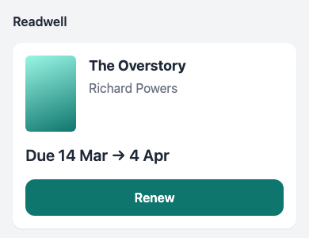
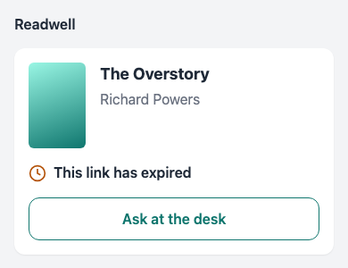

# Reminders before the due date, and renewal from the email

## Problem
Members return copies late. Today the first reminder goes out once a loan is already overdue, and
renewing needs a login most members never use.

## Outcome
Fewer overdue loans: members hear before the due date and can renew in one tap.

## Scope
In: earlier reminder emails, renewal from the email, two renewals per loan, renewals in the loan's
history. Out: push or SMS (ADR 0001), renewing overdue loans online, changes to holds.

## Behavior
1. The nightly job emails a member 3 days before a loan's due date and again on the due date. The
   weekly overdue email stays.
2. Each of those two emails has a Renew button, unless rule 4 or 5 applies.
3. A loan can be renewed twice, 21 days each (ADR 0004).
4. When a hold is waiting for the title, the email says someone is waiting and has no Renew button
   (ADR 0002).
5. An overdue loan can't be renewed from an email; the overdue email says to come to the desk.
6. The Renew button opens a confirm page with the title and the new due date. Pressing Renew there
   renews the loan and shows the new due date. A link that is used up, expired, or for a returned
   loan shows why and what to do.
7. Librarians see every renewal in the loan's history: when, and whether from email or the desk.

## UX
The reminder emails keep the overdue email's layout, with the Renew button or hold notice under the
title. The confirm page was settled with ux-brainstorm.

### Renew confirm page
Approved variant **B, One card** (like Libby's renew sheet): one card on the page background with
the cover, title and author in a row, the due-date change under them in large type, and one
full-width button. Prototype: `.ux-brainstorm/20261110-renew-confirm/confirm-page.html` (local to
the designer's machine).

| State | When | Shows |
| --- | --- | --- |
| Ready | Valid link, renewable loan | Due-date change, Renew button |
| Renewed | Renew pressed | Check icon, "Renewed · due {new}" in place of the button |
| Link used up | The link already renewed this loan | Clock icon, "This link was already used", Ask at the desk |
| Link expired | Past the link's expiry | Clock icon, "This link has expired", Ask at the desk |
| Loan returned | The copy is back | Check icon, "Already returned", no button |

| Element | Renders as |
| --- | --- |
| Page | Server-rendered HTML with the overdue email's "Readwell" header bar, new |
| Card | `<main class="card">`, new |
| Cover | `` 64×96, radius 6px, the title's cover image |
| Due-date change | `
` |
| Renew | `<button type="submit">` in a POST form, filled |
| Ask at the desk | `<a class="btn secondary" href="/desk">`, outlined |

Tokens, all **new** (Readwell has none yet): `--rw-ink #1f2937`, `--rw-muted #6b7280`,
`--rw-accent #0f766e`, `--rw-surface #ffffff`, `--rw-page #f3f4f6`, `--rw-radius 12px`, spacing
16px. Dark: `--rw-ink #f3f4f6`, `--rw-surface #1f2937`, `--rw-page #111827`, accent unchanged.

Copy: "Renew"; "Due {old} → {new}" (dates as "14 Mar"); "Renewed · due {new}"; "This link was
already used"; "This link has expired"; "Already returned"; "Ask at the desk". Icons are Lucide
`clock` and `check`, decorative (`aria-hidden`).

Interactions: focus starts on Renew; Enter submits; the button shows "Renewing…" and is disabled
until the POST returns, then the page swaps to Renewed. Ask at the desk opens the desk's opening
hours.

## Design
- Every renewal is recorded as its own row (loan, when, where from) instead of only a counter, so
  the history in rule 7 has something to show. The limit in rule 3 counts those rows.
- The renew link carries the loan id, an expiry (the due date) and a signature made with a server
  secret (ADR 0005). The confirm page is a GET; renewing is a POST.
- The nightly job picks loans due in 3 days or today, and decides per loan whether the email shows
  the button, the hold notice, or neither (ADR 0006).

## Assumptions
- One reminder per loan per day, even when a member has several loans due.
- The email is plain HTML with a text fallback, like the overdue email.

## Acceptance
- A loan due in 3 days, or today, gets exactly one reminder that night; other loans get none.
- A third renewal is refused with "renewal-limit", from the desk and from the email alike.
- A tampered or expired link never renews, and the page says why.
- Opening the link without pressing Renew changes nothing.
- With a hold waiting, the email has no button and names the reason.
- The loan history lists each renewal with its date and source.

## Slices
1. **Two renewals per loan, each recorded.** Renewals become rows; the limit is 2; desk renewal
   keeps working. Depends on: nothing.
2. **Reminders before the due date.** The nightly job sends the 3-days-before and due-date emails,
   without any button yet. Depends on: nothing.
3. **Renew from a signed link.** The signed link, the confirm page, and the renew action with its
   failure pages. Builds the Renew confirm page. Depends on: slice 1.
4. **Renew button or hold notice in the reminder.** The reminder emails carry the link, or the hold
   notice, or neither when overdue. Depends on: slices 2 and 3.
5. **Renewals in the loan history.** Librarians see each renewal with its date and source. Depends
   on: slice 1.

## Open questions
None.
